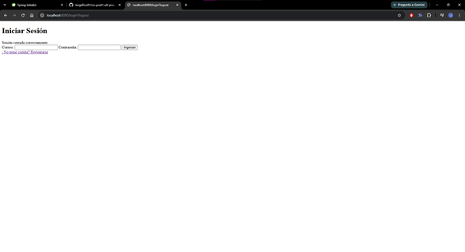
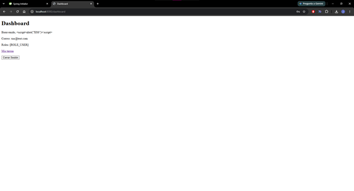
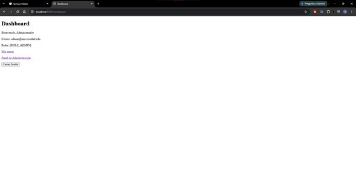
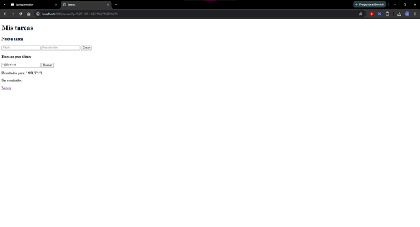
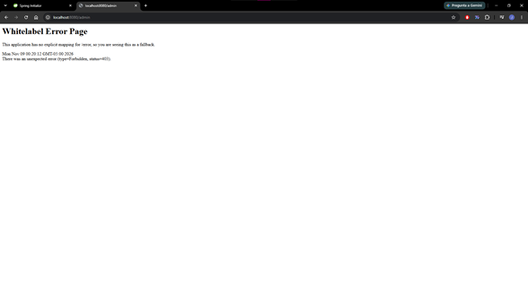
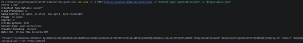
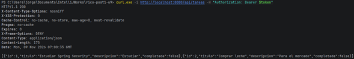
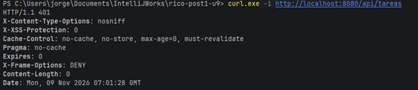

# Unidad 9: Seguridad en Aplicaciones Web

Proyecto Maven Spring Boot (`seguridad-web/`) con dos mecanismos de
autenticación: sesión (form-login) para las vistas Thymeleaf y JWT
stateless para la API REST bajo `/api/**`.

## Arquitectura

Capas: `config`, `controller`, `service`, `repository`, `model`, `security`,
con inyección por constructor.

| Cadena | Orden | Alcance | Mecanismo | CSRF |
|---|---|---|---|---|
| `apiFilterChain` | `@Order(1)` | `/api/**` | JWT stateless (`JwtAuthFilter`) | desactivado |
| `webFilterChain` | `@Order(2)` | `/**` | sesión + form-login | activo |

## Por qué dos mecanismos de autenticación

**Sesión (vistas web):** el navegador guarda una cookie de sesión y la envía
automáticamente. Es lo natural para una app web tradicional, y CSRF debe
seguir activo porque el navegador adjunta la cookie en cualquier petición.

**JWT (API REST):** apps móviles, SPAs en otro dominio o servicios externos no
tienen cookies de sesión. Necesitan una credencial autocontenida en el header
`Authorization`, validada en cada petición sin estado en el servidor. CSRF se
desactiva solo aquí porque no hay cookie que un sitio malicioso pueda reutilizar.

Ninguno reemplaza al otro: resuelven problemas distintos en el mismo sistema.

## Parte 1: Sesión

- Registro con `BCryptPasswordEncoder` (costo 12), login con `UserDetailsService` contra MySQL.
- `/admin/**` solo para ADMIN (`HttpSecurity` + `@PreAuthorize`).
- Acceso a datos con `@Query` parametrizado; la versión concatenada solo aparece como comentario.

### Login y dashboard por rol

### SQL Injection
La entrada `' OR '1'='1` se enlaza como literal con PreparedStatement y no
devuelve resultados. Con la versión concatenada, `'1'='1'` sería siempre
verdadera y devolvería todas las tareas de todos los usuarios.

### CSRF
Un POST a `/logout` sin token responde 403.

## Parte 2: JWT

- `POST /api/auth/login` valida credenciales con el mismo `UserDetailsService` y devuelve un JWT firmado (HMAC) con expiración configurable.
- `JwtAuthFilter` (`OncePerRequestFilter`) valida el token en cada petición y puebla el `SecurityContext`.
- Sin token, con token alterado o expirado: **401**.

### Login y token recibido

### Petición autenticada (200)

### Petición sin token (401)

Mientras se probaba la API, las rutas web siguieron funcionando con sesión.

## Configuración de secretos

Ningún secreto está en el código. Se leen de variables de entorno:

| Variable | Uso |
|---|---|
| `DB_USER` (opcional, por defecto `appuser`) | usuario de MySQL |
| `DB_PASSWORD` | contraseña de MySQL |
| `JWT_SECRET` | clave HMAC en Base64 (mínimo 32 bytes) |
| `JWT_EXPIRATION_MS` (opcional, por defecto 3600000) | vigencia del token |

Generar una clave: `openssl rand -base64 48`

## Cómo ejecutar

1. Clonar el repositorio.
2. Crear la base `seguridad_db` y el usuario en MySQL.
3. Definir las variables de entorno anteriores.
4. Registrar un usuario en `/registro` y promoverlo con
   `UPDATE usuarios SET rol='ROLE_ADMIN' WHERE email='...';`
5. `./mvnw spring-boot:run` dentro de `seguridad-web/`.
6. Web: http://localhost:8080/login, API: `POST http://localhost:8080/api/auth/login`